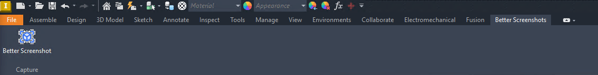
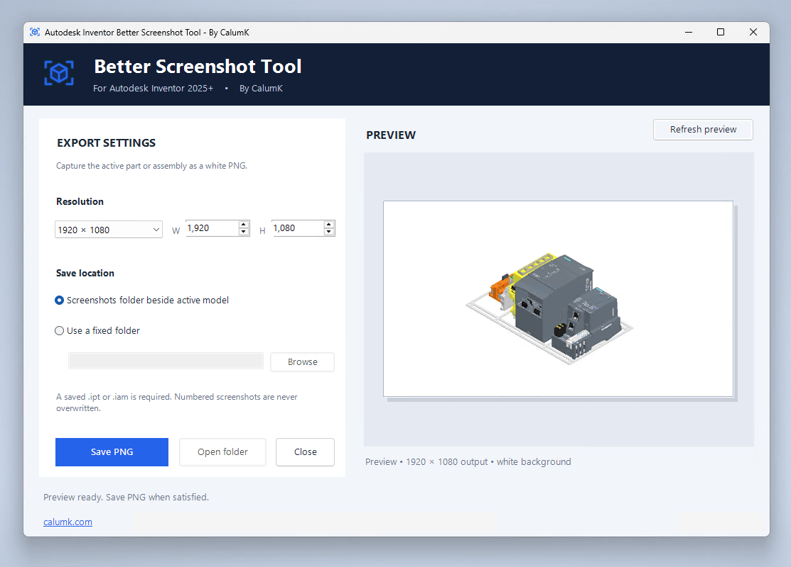

# Autodesk Inventor Better Screenshot Tool — By CalumK

**Version 0.3.1** · **Autodesk Inventor 2025.2.1+** · **Windows x64** · [calumk.com](https://calumk.com)

A lightweight Inventor ribbon add-in for clean **white-background PNG screenshots** of saved `.ipt` and `.iam` files. Set exact output dimensions, check the centred preview, and save with automatic sequential filenames — beside your model or in a fixed folder.

This is an **independent community tool**, not an official Autodesk product.

## Screenshots





## What's new in v0.3.1

- Ribbon button now shows a solid white icon (no more transparency artifacts on Inventor's dark toolbar).
- Centred preview on a grey canvas so white image edges are easy to see.
- Per-user installer that upgrades older versions in place.

## Download

Get the installer from the [**Releases**](https://github.com/calumk/InventorBetterScreenshotTool/releases) page:

- **Current version:** `InventorBetterScreenshotTool-Setup-v0.3.1.exe`

## Requirements

- Windows 10/11 x64 with Autodesk Inventor 2025 (2025.2.1 or newer recommended).
- The part (`.ipt`) or assembly (`.iam`) must be **saved** before capturing.

## Install

1. Close Autodesk Inventor and save your work.
2. Download `InventorBetterScreenshotTool-Setup-v0.3.1.exe` from [**Releases**](https://github.com/calumk/InventorBetterScreenshotTool/releases) and run it.
3. Setup installs for the current Windows user — no administrator rights needed.
4. Restart Inventor 2025; enable the add-in if prompted under **Tools → Add-ins**.

**Unsigned installer warning:** until a trusted code-signing certificate is configured, Windows SmartScreen may show an unrecognized publisher warning. Releases are not currently digitally signed.

## How to use

1. Open a saved part or assembly.
2. Go to **Better Screenshots → Capture → Better Screenshot**.
3. Pick a resolution (e.g. 1920 × 1080) or enter custom W/H values.
4. Choose where to save: **Screenshots folder beside active model** (default) or **a fixed folder**.
5. Press **Refresh preview** to check the shot, then **Save PNG**. **Open folder** jumps to your last save location.

Capturing `D:\Jobs\Widget\Bracket.ipt` with default settings produces:

```text
D:\Jobs\Widget\Screenshots\Bracket_0001.png
D:\Jobs\Widget\Screenshots\Bracket_0002.png
```

Files are numbered automatically and never overwritten. The preview uses a temporary file that is deleted afterwards. Your Inventor background settings are restored after each capture.

## Where things go

- Add-in: `%APPDATA%\Autodesk\Inventor 2025\Addins\InventorScreenshotTool`
- Settings: `%APPDATA%\InventorScreenshotTool\settings.json`

Installing a new version overwrites the add-in files in place. Your settings and screenshots are kept.

## Uninstall

If you installed with `Setup.exe`: **Windows Settings → Installed apps → Autodesk Inventor Better Screenshot Tool → Uninstall**. Screenshots and preferences are left behind, not deleted.

## Limitations

- White-background PNG only. Transparent exports, PDF, and email are out of scope.
- Unsaved models can't be captured — save the `.ipt`/`.iam` first.

## Building from source

See [`DEVELOPMENT.md`](DEVELOPMENT.md) for prerequisites, local builds with `scripts/install.ps1`, the Inno Setup installer, and automated GitHub releases.

## License

Source code is MIT — see [`LICENSE`](LICENSE). The `cube-focus` icon in `src/InventorScreenshotTool/Assets/` is Phosphor Icons (MIT, see `PHOSPHOR_LICENSE.txt`).

Autodesk and Inventor are trademarks of Autodesk, Inc. This tool is independent and not endorsed by Autodesk.
